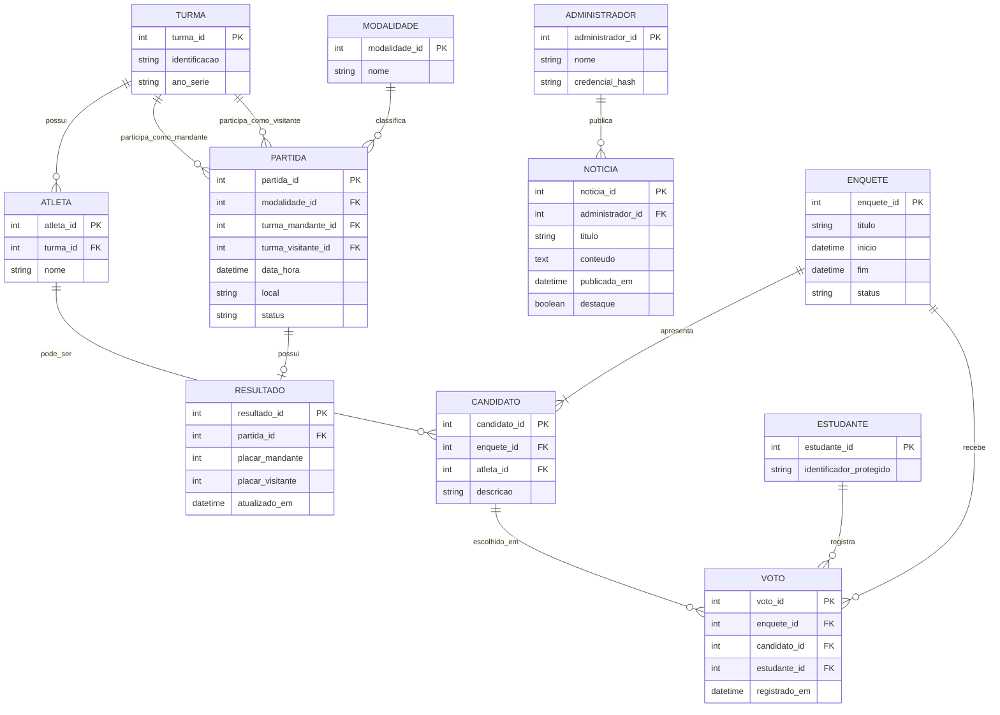

# Diagramas do Interclasse Interativo

Os diagramas Mermaid abaixo descrevem os atores e limites do protótipo. O diagrama de casos de uso retrata interações presentes ou parcialmente presentes. O diagrama entidade-relacionamento é uma **proposta conceitual futura** para uma versão com backend e banco relacional; ele não representa tabelas existentes no código atual.

## 1. Casos de uso

```mermaid
flowchart LR
  Estudante[Estudante / visitante]
  Admin[Administrador demonstrativo<br/>(sem autenticação implementada)]

  subgraph Sistema[Interclasse Interativo — protótipo no navegador]
    UC1((Consultar início e avisos))
    UC2((Consultar notícias))
    UC3((Consultar calendário))
    UC4((Consultar resultados))
    UC5((Consultar galeria))
    UC6((Enviar voto demonstrativo<br/>sem persistência))
    UC7((Cadastrar notícia local))
    UC8((Remover notícia local))
    UC9((Adicionar fotos locais))
    UC10((Cadastrar partida local))
    UC11((Registrar placar))
    UC12((Corrigir placar<br/>com confirmação))
  end

  Estudante --> UC1
  Estudante --> UC2
  Estudante --> UC3
  Estudante --> UC4
  Estudante --> UC5
  Estudante --> UC6

  Admin --> UC1
  Admin --> UC7
  Admin --> UC8
  Admin --> UC9
  Admin --> UC10
  Admin --> UC11
  Admin --> UC12
  Admin --> UC2
  Admin --> UC3
  Admin --> UC4
  Admin --> UC5
```

**Leitura:** os atores distinguem papéis esperados, mas a aplicação não autentica nem autoriza pessoas. As interações administrativas são formulários públicos e locais. O envio de voto é somente uma confirmação visual. Não há caso de uso de edição/remoção de partida ou de apuração de votos porque esses recursos não foram encontrados.

## 2. Modelo entidade-relacionamento proposto para evolução

Este esquema é uma proposta separada da implementação atual. Pode ser revisado quando forem definidos o regulamento do campeonato, os responsáveis por administrar dados e as regras de privacidade.



### Cardinalidades e premissas propostas

- Uma turma pode possuir nenhum ou vários atletas; cada atleta pertence a uma turma.
- Uma partida possui uma modalidade e referencia uma turma mandante e uma visitante. Uma turma pode participar de várias partidas em cada papel.
- Uma partida pode ainda não ter resultado ou possuir um resultado; cada resultado se refere a exatamente uma partida. Se o histórico de correções for necessário, o relacionamento deve ser alterado para permitir múltiplas versões de resultado.
- Um administrador pode publicar várias notícias; cada notícia tem um responsável pela publicação.
- Uma enquete possui um ou mais candidatos e pode receber vários votos. Cada voto escolhe exatamente um candidato e pertence a uma enquete.
- Atleta pode ser candidato em zero ou várias enquetes; cada candidatura referencia um atleta.
- Estudante pode registrar vários votos em enquetes diferentes. Para limitar a um voto por enquete, a proposta deve impor unicidade em `(enquete_id, estudante_id)` e validar elegibilidade no servidor.
- As entidades `ESTUDANTE` e `ADMINISTRADOR` implicam tratamento de identidade. Uma implantação deve minimizar dados pessoais e definir retenção e acesso; a forma de identificação ainda precisa de decisão institucional.

O protótipo usa objetos JSON em armazenamento do navegador e fotos em IndexedDB, não estas entidades ou cardinalidades em um banco de dados.
