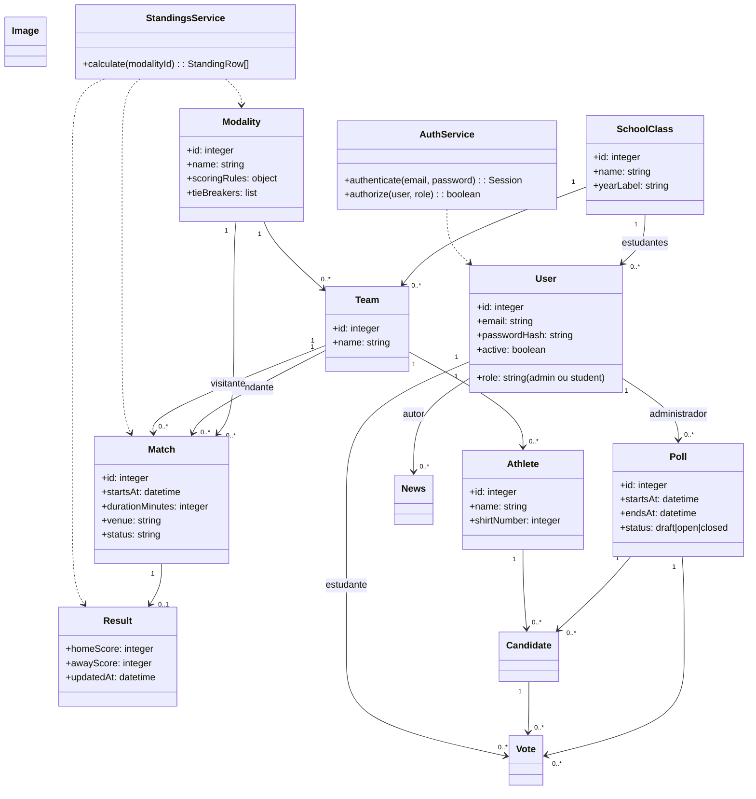
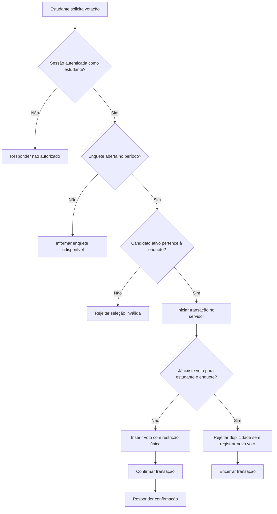

# Diagramas do Interclasse Interativo

Os diagramas representam o **escopo completo pretendido**, e não funcionalidades já implantadas. A interface atual é estática e usa armazenamento do navegador. O arquivo SQL em `../server/db/migrations/001_initial_schema.sql` é uma migração proposta ainda não executada. Os modelos abaixo devem ser atualizados quando regras e arquitetura forem implementadas.

## 1. Casos de uso

```mermaid
flowchart LR
  Visitante[Estudante / visitante]
  Admin[Administrador autenticado\n(versão futura)]
  subgraph Sistema[Interclasse Interativo]
    U1((Consultar notícias e avisos))
    U2((Consultar agenda e resultados))
    U3((Consultar classificação))
    U4((Consultar galeria))
    U5((Votar em enquete aberta))
    A1((Gerenciar turmas, equipes e atletas))
    A2((Gerenciar partidas e placares))
    A3((Gerenciar notícias e imagens))
    A4((Gerenciar votações e candidatos))
    A5((Autenticar e encerrar sessão))
  end
  Visitante --> U1
  Visitante --> U2
  Visitante --> U3
  Visitante --> U4
  Visitante --> U5
  Admin --> A1
  Admin --> A2
  Admin --> A3
  Admin --> A4
  Admin --> A5
  Admin --> U1
  Admin --> U2
  Admin --> U3
  Admin --> U4
```

O ator administrador autenticado é parte da versão futura. Atualmente, a área é pública e o voto não é gravado. Os casos de uso de cadastro e votação compartilhada permanecem pendentes.

## 2. Entidade-relacionamento proposto

Este ER acompanha as entidades e chaves da migração SQLite proposta. Não representa tabelas que já estejam sendo usadas pelo site.

```mermaid
erDiagram
  SCHOOL_CLASSES o|--o{ USERS : associa
  SCHOOL_CLASSES ||--o{ TEAMS : organiza
  MODALITIES ||--o{ TEAMS : define
  TEAMS ||--o{ ATHLETES : compoe
  MODALITIES ||--o{ MATCHES : classifica
  TEAMS ||--o{ MATCHES : mandante
  TEAMS ||--o{ MATCHES : visitante
  USERS ||--o{ MATCHES : cadastra
  MATCHES ||--o| RESULTS : recebe
  USERS ||--o{ RESULTS : atualiza
  USERS ||--o{ NEWS : publica
  USERS ||--o{ IMAGES : envia
  USERS ||--o{ POLLS : cria
  POLLS ||--o{ CANDIDATES : apresenta
  ATHLETES ||--o{ CANDIDATES : concorre
  POLLS ||--o{ VOTES : recebe
  CANDIDATES ||--o{ VOTES : escolhida
  USERS ||--o{ VOTES : estudante_vota
  USERS ||--o{ AUDIT_LOG : executa

  SCHOOL_CLASSES {
    int id PK
    string name UK
    string year_label
  }
  USERS {
    int id PK
    string email UK
    string password_hash
    string role
    int class_id FK
    boolean active
  }
  MODALITIES {
    int id PK
    string name UK
    int points_win
    int points_draw
    int points_loss
    string tie_breakers_json
  }
  TEAMS {
    int id PK
    int class_id FK
    int modality_id FK
    string name
  }
  ATHLETES {
    int id PK
    int team_id FK
    string name
    int shirt_number
  }
  MATCHES {
    int id PK
    int modality_id FK
    int home_team_id FK
    int away_team_id FK
    string starts_at
    int duration_minutes
    string venue
    string status
  }
  RESULTS {
    int id PK
    int match_id FK_UK
    int home_score
    int away_score
    int updated_by FK
  }
  NEWS {
    int id PK
    int author_id FK
    string title
    string content
    string status
    boolean featured
  }
  IMAGES {
    int id PK
    string storage_key UK
    string mime_type
    int byte_size
    string caption
    string alt_text
    boolean consent_confirmed
    int uploaded_by FK
  }
  POLLS {
    int id PK
    int created_by FK
    string title
    string category
    string starts_at
    string ends_at
    string status
  }
  CANDIDATES {
    int id PK
    int poll_id FK
    int athlete_id FK
    string description
  }
  VOTES {
    int id PK
    int poll_id FK
    int candidate_id FK
    int student_id FK
    string created_at
  }
  AUDIT_LOG {
    int id PK
    int actor_id FK
    string action
    string entity_type
    int entity_id
  }
```

### Relacionamentos e integridade

- `USERS.role` separa `admin` e `student`; estudante pode pertencer a uma turma. Autorização deve ser verificada no servidor.
- Uma equipe pertence a uma turma e a uma modalidade. Cada atleta pertence a uma equipe; a unicidade por equipe/nome reduz duplicidade.
- Partida referencia modalidade e duas equipes distintas. Chaves estrangeiras compostas propostas fazem as equipes pertencerem à modalidade do jogo.
- Resultado é opcional e único por partida; correções atualizam autoria e data. Para histórico imutável, seria necessária uma tabela adicional de versões.
- Os valores de pontos e desempate ficam por modalidade, evitando misturar modalidades. A configuração inicial é ilustrativa e depende de validação da comissão.
- A chave única de voto proposta `(poll_id, student_id)` limita um voto por estudante/enquete. O servidor ainda precisa confirmar identidade, janela e situação da enquete e pertencimento do candidato.
- Arquivo de imagem fica fora do banco; metadados e estado de consentimento ficam na tabela `images`. A caixa de consentimento ainda não equivale a validação legal ou autorização obtida.
- A tabela `audit_log` registra ações administrativas importantes sem guardar senhas ou segredos.

## 3. Diagrama de classes proposto



É um modelo lógico de proposta para organizar responsabilidades; não existe código de classes no projeto atual, que usa JavaScript no navegador.

## 4. Fluxo de votação proposto



O fluxo ainda não existe no protótipo: o formulário apenas muda o texto de feedback. Um identificador confiável de estudante e critérios para apuração precisam ser aprovados pela escola antes de implementar votos reais.

## 5. Sequência proposta: cadastrar partida e atualizar resultado

```mermaid
sequenceDiagram
  actor Admin as Administrador
  participant UI as Interface web
  participant API as Express API
  participant Auth as Sessão/autorização
  participant DB as SQLite

  Admin->>UI: Preenche e envia partida
  UI->>API: POST /api/matches + token CSRF
  API->>Auth: Validar sessão e função admin
  Auth-->>API: Usuário autorizado
  API->>API: Validar campos e conflito de horário/local
  API->>DB: BEGIN; inserir partida com parâmetros
  DB-->>API: id da partida
  API->>DB: COMMIT
  API-->>UI: 201 + partida criada

  Admin->>UI: Informa placar e confirma correção
  UI->>API: PUT /api/matches/{id}/result + token CSRF
  API->>Auth: Validar sessão e função admin
  Auth-->>API: Usuário autorizado
  API->>API: Validar placar e regras da modalidade
  API->>DB: BEGIN; inserir/atualizar resultado e status
  DB-->>API: atualização concluída
  API->>DB: COMMIT
  API-->>UI: 200 + resultado
  UI->>API: GET /api/standings?modality=...
  API->>DB: Consultar partidas, resultados e regras da modalidade
  API-->>UI: Classificação recalculada
```

O diagrama descreve o comportamento que deverá ser desenvolvido. Nenhum endpoint/API ou conta autenticada está presente atualmente.
